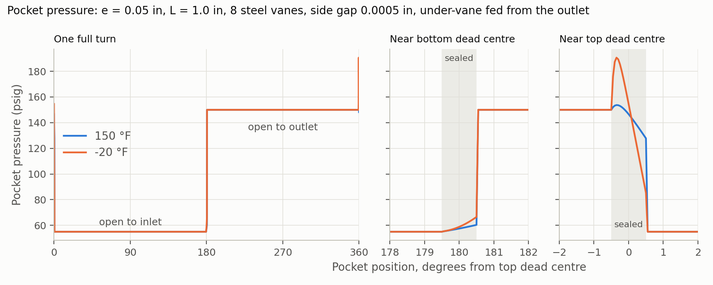
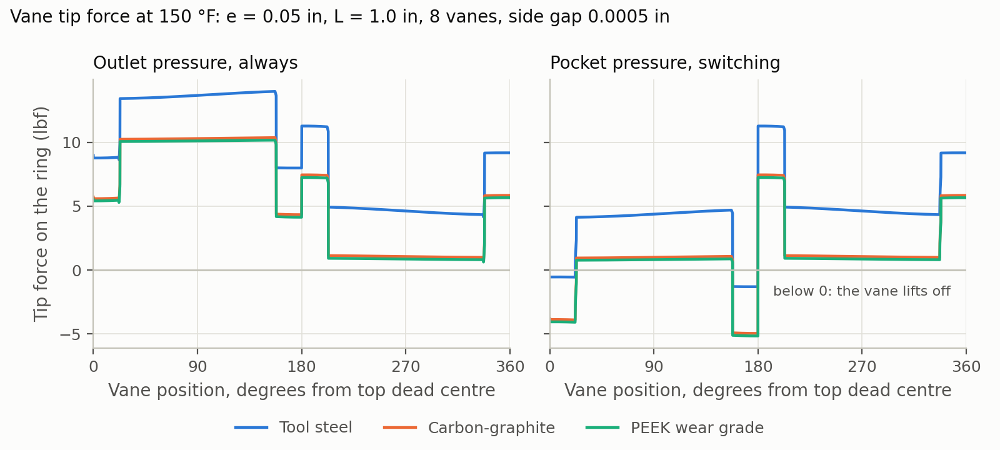
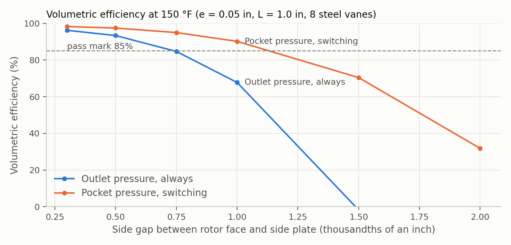

# Functional design

Rubric: *ability to make functionally sound design choices* (17.5%).

## Operating principle

A slotted rotor turns inside a cam ring. Vanes slide in the rotor slots and are held against the ring by centrifugal
force, plus under-vane pressure or springs. The ring is shaped (offset, or non-circular) so the space between two
adjacent vanes grows over the inlet port and shrinks over the outlet port. Each pocket fills with liquid and then
pushes it out. A standard motor outside the bolted housing drives the pump shaft through a magnetic coupling, across
a containment can that keeps the refrigerant in ([D33](decisions.md), [below](#magnetic-drive)).

## Sizing

The rotor diameter is fixed at 3.1 in. The free variables are eccentricity e (or cam stroke s), rotor length L, vane
count z and vane thickness t.

### Displacement

Treat the liquid between vanes as rotating rigidly with the rotor. Where the ring sits at radius ρ from the rotor
centre, the flow crossing a radial line is q = ωL(ρ² − R_r²)/2. Net delivery is the difference in q between the
widest and narrowest points.

- **Single-lobe** (round ring of diameter D_c, offset e): ρ runs from R_c − e to R_c + e, so per revolution
  V = πL(ρ_max² − ρ_min²) = 2πeLD_c. The vanes stroke 2e once per revolution and take up z·t·2e·L, giving
  **V = 2eL(πD_c − zt)**, with D_c = D_r + 2e when the rotor is tangent to the ring at the seal arc.
- **Balanced double-lobe** (cam ring with major radius R_a, minor radius R_b ≈ R_r, stroke s = R_a − R_b): there are
  two suction and two discharge zones per revolution, giving **V = 2L[π(R_a² − R_b²) − zts]**.

Checked against the pocket geometry (2026-11-10, [vane-pocket model](#level-1-vane-pocket-model)): integrating each
pocket's area at its smallest and largest gives the swept volume directly, with no formula. Two results:

- **Esposito's V = (π/2)(D_c + D_r)eL is the crescent volume**, the liquid between rotor and ring at one instant
  (π(R_c² − R_r²)L). Each pocket swings from nearly empty to twice the crescent's average height, so the swept volume
  per turn is about twice the crescent. The 2eL(πD_c − zt) form is the right one.
- **2eL(πD_c − zt) is exact only for many vanes.** It takes each pocket's volume at the single widest and narrowest
  points, but a real pocket spans a whole vane pitch. At e = 0.05 in, L = 1 in, the exact swept volume is lower by
  3.9% (6 vanes), 2.1% (8), 1.3% (10) and 0.8% (12). The tables below use the formula, so they read 1–4% high. It
  also assumes the under-vane spaces return what they take in; if they are fed from the pocket's own port, they
  pump too and add z·t·2e·L.

Theoretical flow from [calcs/displacement.py](../calcs/displacement.py) at 3600 RPM, 100% volumetric efficiency, with
placeholder z = 8 and t = 0.10 in:

**Single-lobe**, flow in GPM:

| Eccentricity e (in) | L = 0.75 in | L = 1.0 in | L = 1.5 in | L = 2.0 in |
|---|---|---|---|---|
| 0.050 | 10.8 | 14.4 | 21.6 | 28.8 |
| 0.075 | 16.5 | 22.0 | 33.0 | 44.0 |
| 0.100 | 22.4 | 29.8 | 44.7 | 59.6 |
| 0.125 | 28.4 | 37.9 | 56.8 | 75.8 |
| 0.150 | 34.6 | 46.2 | 69.3 | 92.4 |

**Balanced double-lobe**, flow in GPM:

| Cam stroke s (in) | L = 0.75 in | L = 1.0 in | L = 1.5 in | L = 2.0 in |
|---|---|---|---|---|
| 0.050 | 10.6 | 14.2 | 21.3 | 28.4 |
| 0.075 | 16.1 | 21.4 | 32.2 | 42.9 |
| 0.100 | 21.6 | 28.8 | 43.3 | 57.7 |
| 0.125 | 27.3 | 36.4 | 54.5 | 72.7 |
| 0.150 | 33.0 | 44.0 | 66.0 | 88.0 |

Hydraulic power at Δp = 95 psi is 0.055 hp per GPM (10 GPM is 0.55 hp before losses).

What the tables show:

- A 3.1 in rotor at 3600 RPM is a high-flow pump even at small eccentricity: about 14 GPM at e = 0.05 in, L = 1 in.
  The smallest corner of the table (e = 0.05 in, L = 0.75 in) still gives about 11 GPM theoretical.
- For the same total vane travel per revolution, the two layouts give nearly the same flow. In the balanced pump
  each vane travels half as far per stroke but strokes twice per revolution.

### Smallest practical pump

Flow is an output ([D10](decisions.md)): we shrink e and L as far as they can go and report the flow that results.
What stops further shrinking:

- **Volumetric efficiency.** Leakage through the side, tip and slot clearances depends on clearance size, Δp and
  viscosity, not on e. As displacement shrinks, leakage becomes a larger share of it. In a liquid this thin
  (0.114 cP at 150 °F), this is probably the binding limit. A leakage model is the next calculation.
- **Manufacturing tolerance on e.** At e = 0.05 in, a ±0.001 in error in ring or rotor position is ±2% of
  displacement.
- **Vane proportions.** The vane has to stay well supported in its slot while extended by 2e, and very short vanes
  (small L) tilt more under the pressure difference across them.
- **Shaft, bearing span and coupling packaging** in the housing.

The vane-pocket model now gives the leakage side of this ([results below](#smallest-practical-pump-from-the-model)).
With a 0.0005 in side gap, leakage stops being the binding limit: manufacturing tolerance on e, vane proportions and
the under-vane feed take over.

## Modeling plan

The calculations go up in levels of detail. Each question gets the simplest model that can answer it, and a more
detailed model only where it could change the decision.

| Level | Model | What it answers | Status |
|---|---|---|---|
| 0 | Ideal displacement ([calcs/displacement.py](../calcs/displacement.py)) | Flow vs. e and L | Done |
| 1 | Chamber and leakage model: each vane pocket as a control volume, pressure vs. shaft angle, leakage through the side, tip and slot clearances, port timing | Volumetric efficiency, real flow, pressure ripple, shaft power. Sets the smallest practical pump ([Q2](open-questions.md)) and the clearance budget. | Built for the single-lobe layout ([below](#level-1-vane-pocket-model)); balanced layout to add |
| 2 | Vane dynamics: centrifugal force, under-vane pressure, friction and inertia on each vane | Tip contact force, lift-off, PV and wear rate. Feeds the 50,000 h wear allowance in [calcs/reliability.py](../calcs/reliability.py). | Started: the Level 1 model computes tip force, friction and lift-off. Under-vane timing ([Q30](open-questions.md)), PV and wear next |
| 3 | Finite-element analysis | Vane, rotor and shaft fatigue ([infinite life](#fatigue)), housing and can stress at the 300 psig design pressure ([D32](decisions.md)), deflections that use up clearance | Planned; tool proposed in [D6](decisions.md#d6-tooling) |
| 4 | 3D CFD with a moving mesh | Port shape, local flow losses | Only if a lower level can't answer a question |

How each step is checked:

- **Verification**: the code does the math right. Compare against a hand calculation.
- **Validation**: the math matches reality. Compare against published or test data.

Material properties from the Granta screen ([materials.md](materials.md#selection-in-granta)) are inputs to these
models: expansion sets the clearance change over temperature and so the leakage, density sets the vane tip force, and
fatigue strength sets the safety factor. In the other direction, the clearance budget from Level 1 sets how closely
the stack materials' expansion has to match.

### Order of work

Set 2026-11-12. The levels above are the models. The hand checks below fill the gaps between them, for the bearings,
the coupling, the ports and the relief. Each step uses results from the steps before it. The tool for each step,
with an industry-standard option, is in [D6](decisions.md#d6-tooling).

| Step | Work | Uses | Status |
|---|---|---|---|
| 1 | Ideal flow (Level 0) | — | Done |
| 2 | Vane-pocket model (Level 1). Add the balanced layout, then choose the layout ([D7](decisions.md)) | Step 1 | Single-lobe done; balanced layout next |
| 3 | Vane forces and wear (Level 2): fix the lift-off ([Q30](open-questions.md)), then PV and wear life | Step 2 | Started |
| 4 | Port pressure drop, by hand ([Q29](open-questions.md)) | Flow from step 2 | Not started |
| 5 | Bearing load and life ([D16](decisions.md), [bearing trade](#bearing-trade-study)) | Side load from steps 2–3 | Not started |
| 6 | Magnetic coupling: start-up torque at −20 °F, breakaway torque, and eddy-current heat if the can is metal ([Q28](open-questions.md), [Q22](open-questions.md)) | Torque from steps 2–3 | Not started |
| 7 | Relief valve set point and size, by hand ([Q27](open-questions.md)) | Flow from step 2, [calcs/pressure_cases.py](../calcs/pressure_cases.py) | Not started |
| 8 | FEA (Level 3) | Final part shapes and sizes from steps 2–7 | Planned |
| 9 | CFD (Level 4) | Only if a step above can't answer a question | — |

Why this order:

- **The layout is chosen early.** It sets the bearing load, the ring shape and the port plates, so every step after
  step 2 depends on it.
- **FEA comes late,** so it runs on the final shapes and sizes instead of being redone after each change.
- **Cavitation isn't analysed,** because [D9](decisions.md) keeps the fluid liquid at all times.

### Level 1: vane-pocket model

[calcs/vane_pocket_model.py](../calcs/vane_pocket_model.py), built 2026-11-10 for the single-lobe layout. It follows
each pocket between two vanes through a turn of the rotor and tracks the pressure in it. From the pocket pressures it
works out the real flow, the shaft torque and power, and the force holding each vane tip on the ring. It is a "0D"
model: each pocket has one pressure, not a 3D flow field. About 33,000 cases run in under a minute.

#### Choices

Agreed with the team on 2026-11-10.

| Item | Choice | Why |
|---|---|---|
| Layout | Single-lobe first; balanced added later ([D7](decisions.md)) | Simpler to build and check |
| Side gap (rotor face to side plate) | Swept from 0.0003 to 0.002 in | Leakage grows with the cube of the gap; the result sets the machining tolerance |
| Pass mark | Volumetric efficiency ≥ 85% at 150 °F ([D34](decisions.md)) | Defines the smallest practical pump |
| Temperatures | 150 °F and −20 °F | [D9](decisions.md)'s bounding cases: thinnest liquid (most leakage) and thickest (most drag) |
| Under-vane feed | Both compared: **outlet pressure, always** under every vane; **pocket pressure, switching**, with grooves feeding inlet pressure over 0–180° and outlet pressure over 180–360° | What holds the vanes out decides leakage, friction and lift-off |
| Vane count | 6 to 12 | |
| Port edges | Plain, each land 1° wider than a pocket's opening; notches later | |
| Vane material | Tool steel, carbon-graphite, PEEK wear grade. Each sets the vane mass and, through its expansion, the vane-end and slot gaps at temperature. | Feeds the vane choice ([materials.md](materials.md#current-choices)) |
| Friction | 0.15, vane tip on ring and vane in slot | Rubbing in a thin liquid with no oil ([Q3](open-questions.md)); errs toward more power |
| Ports | Big enough to have no pressure loss: pockets see exactly 55 and 150 psig | Port sizing comes later ([Q29](open-questions.md)) |

The vane tip gap is not swept. A tip touches the ring, so its gap is set by surface roughness, not by machining.

#### How it works

1. **Pocket volume.** Seen from the rotor centre, the ring sits at ρ(θ) = −e cos θ + √(R_c² − e² sin² θ), with the
   ring touching the rotor at top dead centre (R_c = R_r + e). A pocket's cross-section is ∫(ρ² − R_r²)/2 dθ between
   its two vanes, less half of each vane's exposed part.
2. **Ports.** A pocket is open to the inlet over 0–180° and to the outlet over 180–360°. At each dead centre it is
   sealed for 1° as it changes over.
3. **Leakage** through four paths (table below), each a thin-film flow, Q ∝ gap³ × Δp / viscosity.
4. **Pressure.** Open pockets sit at port pressure. A sealed pocket follows dp/dt = (β/V)(Q_leak − dV/dt). β = ρa²
   from CoolProp is 100 MPa at 150 °F and 790 MPa at −20 °F. Hydraulic oil is about 1,500 MPa, so R-134a is much
   springier. When a sealed pocket opens, the port pushes in, or takes out, the volume that brings it to port
   pressure.
5. **Vane forces.** Pushing a vane out: spinning (m ω² r) and the under-vane pressure. Pushing it in: the average of
   the two pocket pressures on its tip, its own radial acceleration, and slot friction. The rest is the tip force on
   the ring. Below zero, the vane lifts off.
6. **Torque.** Pressure on each vane's exposed faces, the ring's push on each tip (which leans with the ring's
   slope), friction, and viscous drag on the rotor faces.

The whole pump repeats every vane pitch, so the model runs one pitch, after one pitch of warm-up, in 0.05° steps.

| Leakage path | How it's modelled | Notes |
|---|---|---|
| Rotor faces to side plates, both sides | Thin-film (Reynolds) flow in the side gap, solved exactly on the ring-shaped face from the slot bottoms to the rotor rim with a Fourier series. Rim at the pocket pressures, ramping across each vane end; inner edge at the under-vane groove pressure. | The main path. For the switching feed, liquid also flows from the outlet groove to the inlet groove across the face inside the grooves, which is assumed to dead-end at the shaft ([Q32](open-questions.md)). |
| Vane ends | Gap across the vane thickness, over the vane's exposed height | The gap changes with temperature by vane material |
| Vane tips | 0.0001 in effective gap (surface roughness) over a 0.02 in land | Tiny while the vane touches the ring |
| Vane slots | 0.0005 in gap down one side of the vane, over the length still in the slot, between the under-vane space and the neighbouring pocket with the larger pressure difference | The gap changes with temperature by vane material |

Placeholders, to replace as the vane, shaft and port design firms up:

| Placeholder | Value |
|---|---|
| Vane thickness | 0.10 in (as in [calcs/displacement.py](../calcs/displacement.py)) |
| Vane height | max(6e, 0.25 in), so two thirds of the vane stays in its slot at full stroke |
| Inner edge of the rotor face | 0.375 in radius (0.75 in shaft) |
| Gaps set at | 68 °F. Ring, side plates and rotor expand alike (6.5 µstrain/°F), so the side gap holds over temperature. |
| Tool steel vane | 0.283 lb/in³, 6.5 µstrain/°F |
| Carbon-graphite vane | 0.065 lb/in³ (1.8 g/cm³), 2.5 µstrain/°F: typical values; supplier data pending ([D23](decisions.md)) |
| PEEK wear grade vane | 0.053 lb/in³, 5.55 µstrain/°F: the Granta record in [materials.md](materials.md#vane-screen-in-granta) |

#### Verification

The code is checked against cases with known answers ([how each step is checked](#modeling-plan)). Reference pump:
e = 0.05 in, L = 1.0 in, 8 vanes, side gap 0.0005 in.

| Check | Expected | Model | Result |
|---|---|---|---|
| Rigid liquid, no gaps, no friction (outlet feed): delivered flow equals the swept volume | 14.115 GPM | 14.115 GPM | 0.00% off |
| No gaps, friction or drag (outlet feed): mean torque equals swept volume × Δp / 2π | 13.69 in·lbf | 13.69 in·lbf | 0.00% off |
| Same two checks, switching feed | 15.362 GPM, 14.90 in·lbf | 15.362 GPM, 14.90 in·lbf | 0.00%, 0.02% off |
| Side gap: flow into the pockets from the faces equals flow out of the grooves (both feeds) | equal | equal | 0.000% off |
| Energy balance at 150 °F: shaft power = swept volume × Δp + friction + drag | 0% left over | −0.00% (outlet), −0.04% (switching) | closes |
| Volume balance: inlet flow − outlet flow = compression of the pockets' swept volume | 0.0924 GPM | 0.0923 GPM | 0.1% off |
| Side-gap solver: 2,048 against 8,192 points around the rim | 0.3918 GPM leakage | 0.3918 GPM | 0.01% off |

Not yet validated against test data from a real pump (to find: published vane-pump leakage or efficiency data at a
known clearance).

#### Results: reference pump

e = 0.05 in, L = 1.0 in, 8 vanes, side gap 0.0005 in.

| Under-vane feed | Vane | Temp (°F) | Swept (GPM) | Delivered (GPM) | Vol. eff. | Shaft (hp) | Hydraulic (hp) | Overall eff. | Tip friction (hp) | Mean / peak torque (in·lbf) | Tip force min / max (lbf) |
|---|---|---|---|---|---|---|---|---|---|---|---|
| Outlet, always | Tool steel | 150 | 14.12 | 13.18 | 93.4% | 1.81 | 0.73 | 40% | 1.01 | 31.7 / 32.4 | 4.2 / 14.0 |
| Outlet, always | Tool steel | −20 | 14.12 | 13.86 | 98.2% | 1.84 | 0.77 | 42% | 1.01 | 32.2 / 33.0 | 2.3 / 14.0 |
| Outlet, always | Carbon-graphite | 150 | 14.12 | 13.07 | 92.6% | 1.43 | 0.72 | 51% | 0.63 | 24.9 / 25.6 | 0.8 / 10.4 |
| Outlet, always | Carbon-graphite | −20 | 14.12 | 13.88 | 98.4% | 1.46 | 0.77 | 53% | 0.63 | 25.5 / 26.5 | **−1.1** / 10.4 |
| Outlet, always | PEEK wear grade | 150 | 14.12 | 13.15 | 93.2% | 1.40 | 0.73 | 52% | 0.61 | 24.6 / 25.3 | 0.6 / 10.2 |
| Outlet, always | PEEK wear grade | −20 | 14.12 | 13.87 | 98.2% | 1.44 | 0.77 | 54% | 0.61 | 25.1 / 26.0 | **−1.3** / 10.2 |
| Switching | Tool steel | 150 | 15.36 | 14.97 | 97.4% | 1.38 | 0.83 | 60% | 0.51 | 24.1 / 24.9 | **−1.3** / 11.3 |
| Switching | Tool steel | −20 | 15.36 | 15.26 | 99.4% | 1.41 | 0.85 | 60% | 0.51 | 24.7 / 26.1 | **−1.3** / 11.3 |
| Switching | Carbon-graphite | 150 | 15.36 | 14.90 | 97.0% | 1.04 | 0.83 | 79% | 0.18 | 18.2 / 18.8 | **−4.9** / 7.5 |
| Switching | Carbon-graphite | −20 | 15.36 | 15.28 | 99.4% | 1.07 | 0.85 | 79% | 0.18 | 18.8 / 19.5 | **−4.9** / 7.5 |
| Switching | PEEK wear grade | 150 | 15.36 | 14.96 | 97.4% | 1.02 | 0.83 | 81% | 0.16 | 17.9 / 18.4 | **−5.2** / 7.2 |
| Switching | PEEK wear grade | −20 | 15.36 | 15.27 | 99.4% | 1.05 | 0.85 | 80% | 0.16 | 18.4 / 19.1 | **−5.2** / 7.2 |

Bold: the vane lifts off the ring somewhere in the turn. Where it does, the leakage and power figures assume the vane
stays on the ring, so they are optimistic there.

Sealed-zone pressure, steel vanes:

| Under-vane feed | Temp (°F) | Lowest pocket pressure (psig) | Highest pocket pressure (psig) |
|---|---|---|---|
| Outlet, always | 150 | 55 | 154 |
| Outlet, always | −20 | 55 | 191 |
| Switching | 150 | 55 | 150 |
| Switching | −20 | 55 | 155 |

Vane gaps at temperature (both set at 68 °F: vane end = side gap 0.0005 in, slot 0.0005 in):

| Vane | Temp (°F) | Vane-end gap, each end (in) | Slot gap (in) |
|---|---|---|---|
| Tool steel | 150 / −20 | 0.00050 / 0.00050 | 0.00050 / 0.00050 |
| Carbon-graphite | 150 / −20 | 0.00066 / 0.00032 | 0.00053 / 0.00046 |
| PEEK wear grade | 150 / −20 | 0.00054 / 0.00046 | 0.00051 / 0.00049 |

#### Results: side gap, size and vane count

Volumetric efficiency against side gap at the reference size, steel vanes:

| Side gap (in) | Outlet, always, 150 °F | Outlet, always, −20 °F | Switching, 150 °F | Switching, −20 °F |
|---|---|---|---|---|
| 0.0003 | 96% | 99% | 98% | 100% |
| 0.0005 | 93% | 98% | 97% | 99% |
| 0.00075 | 85% | 96% | 95% | 99% |
| 0.001 | 68% | 91% | 90% | 97% |
| 0.0015 | flows backwards | 71% | 70% | 92% |
| 0.002 | flows backwards | 32% | 32% | 80% |

"Flows backwards": more liquid leaks from outlet to inlet than the pump moves.

##### Smallest practical pump, from the model

Smallest swept volume with volumetric efficiency ≥ 85% at 150 °F, 8 steel vanes. The sweep covers e = 0.015–0.15 in
and L = 0.5–2.0 in. Each cell: e × L (in), then delivered flow and volumetric efficiency. `*` marks the smallest size
tried, so the leakage limit lies below the sweep.

| Side gap (in) | Outlet, always | Switching |
|---|---|---|
| 0.0003 | 0.02 × 0.5: 2.4 GPM, 88% | 0.015 × 0.5*: 2.1 GPM, 95% |
| 0.0005 | 0.04 × 0.5: 4.8 GPM, 85% | 0.015 × 0.5*: 2.0 GPM, 90% |
| 0.00075 | 0.08 × 0.5: 10.1 GPM, 88% | 0.015 × 1.0: 3.9 GPM, 86% |
| 0.001 | 0.125 × 0.5: 16.1 GPM, 87% | 0.025 × 1.5: 9.9 GPM, 87% |
| 0.0015 | 0.125 × 1.5: 47.5 GPM, 85% | 0.06 × 2.0: 32.2 GPM, 87% |
| 0.002 | none in the sweep | none in the sweep |

Vane count at the reference size, side gap 0.0005 in, steel vanes, 150 °F:

| Vanes | Outlet, always: vol. eff. | Outlet, always: shaft hp | Switching: vol. eff. | Switching: shaft hp | Switching: lowest tip force (lbf) |
|---|---|---|---|---|---|
| 6 | 93.8% | 1.56 | 97.4% | 1.24 | −1.3 |
| 8 | 93.4% | 1.81 | 97.4% | 1.38 | −1.3 |
| 10 | 92.8% | 2.05 | 97.5% | 1.51 | −1.3 |
| 12 | 92.3% | 2.29 | 97.5% | 1.64 | −1.3 |

Vane material barely changes leakage: at the reference size and 150 °F, the three materials are within 1.5 points
of each other at both 0.0005 and 0.001 in.

#### What it means

1. **The side gap is the main lever.** Leakage across the rotor faces dominates. With the outlet feed, the pump needs
   a side gap of 0.0005 in or less; with the switching feed, up to about 0.001 in passes the 85% mark at the
   reference size. Holding 0.0005 in means lapped or ground faces and a tight tolerance on rotor length against ring
   thickness ([Q31](open-questions.md), [manufacturing.md](manufacturing.md#critical-to-function-features)).
2. **At 0.0005 in, leakage no longer limits how small the pump can be.** With the switching feed, even the smallest
   size tried (e = 0.015 in, L = 0.5 in, 2 GPM) passes. The limit then comes from what can be made: at e = 0.02 in, a
   ±0.001 in error in ring or rotor position is ±5% of the flow. [Q2](open-questions.md) is now a manufacturing
   question.
3. **The under-vane feed is the biggest design choice in the model.** Feeding outlet pressure under every vane
   leaks across the rotor faces from the under-vane groove into the whole inlet half, and presses each vane on the
   ring with about 9.5 lbf more in the inlet half. With steel vanes, tip friction (1.0 hp) is more than the useful
   hydraulic power (0.73 hp), and overall efficiency is 40%. The switching feed leaks less (97% against 93%) and
   wastes less (60–81% overall).
4. **But with the switching feed the vanes lift off at the two sealing positions,** where one vane separates an
   outlet pocket from an inlet pocket while it still has inlet pressure under it. The tip sees the average of the two
   pockets, which outweighs spinning: −1.3 lbf for steel, about −5 lbf for carbon-graphite and PEEK. A lifted vane
   leaks and chatters. The fix is in the vane design: give the sealing vane outlet pressure underneath (move the
   groove ends by half a vane pitch), or use intra-vane or chamfered-tip vanes ([Q30](open-questions.md)).
5. **Light vanes cut friction about threefold.** Carbon-graphite and PEEK press on the ring far less than steel:
   0.16–0.18 hp of tip friction against 0.51 hp with the switching feed. Lower tip force also means less wear
   ([vane tip wear](#vane-tip-wear)). They are also the ones that lift off, so they need the fix in point 4.
6. **Vane count hardly changes leakage, but every vane adds friction.** From 6 to 12 vanes, shaft power rises from
   1.24 to 1.64 hp (switching) while volumetric efficiency stays at 97%. Fewer vanes are cheaper on both counts; the
   lower limit comes from pulsation and sealing.
7. **150 °F sets the size and −20 °F barely changes the torque.** Leakage at −20 °F is a third or less of that at
   150 °F (viscosity is 3.5× higher). Running torque at −20 °F is only about 2% higher, because friction, not the
   liquid's drag, dominates. The magnetic coupling sees a peak running torque of 18–33 in·lbf at the reference size,
   depending on feed and vane. Start-up torque isn't modelled yet.
8. **Plain ports are adequate for now.** With a 1° land overlap, the pocket trapped at top dead centre peaks at
   191 psig at −20 °F (outlet feed) and 155 psig (switching). Port notches can wait.
9. **The vane materials' expansion is acceptable for the grades in the docs.** Carbon-graphite opens the vane-end
   gap to 0.00066 in at 150 °F and closes it to 0.00032 in at −20 °F; the PEEK wear grade moves less than
   0.00005 in. Unfilled PEEK (about 26 µstrain/°F) would close the vane-end gap by about 0.0008 in per end at 150 °F
   and rub, so only filled or wear grades are candidates.

#### Not modelled yet

- Port pressure loss: the ports are ideal until they are sized ([Q29](open-questions.md)).
- What happens after a vane lifts off: the model flags it and carries on as if the vane stayed on the ring.
- Compressibility of the liquid in the under-vane spaces, and the switch of those spaces between grooves.
- Where the bearing and containment-can cavity drains: the face inside the grooves is taken as a dead end
  ([Q32](open-questions.md)).
- Rotor tilt, face flatness and deflection under pressure: the side gap is taken as uniform and the rotor as
  centred between the side plates.
- Start-up and the breakaway torque the coupling must pass.
- Cavitation and vapor ([D9](decisions.md)).
- The balanced layout ([D7](decisions.md)).

## Vane layout trade study

Decision [D7](decisions.md) is open.

| Factor | Single-lobe (eccentric round ring) | Balanced double-lobe (elliptical cam ring) |
|---|---|---|
| Radial bearing load | Net hydraulic load of roughly Δp × D_c × L: about 300 lbf per inch of rotor length at 95 psi. The bearings carry it in a thin fluid. | The two opposed pressure zones cancel, leaving almost no net radial load. |
| Bearing life vs. 50,000 h | Harder. A thin-fluid sleeve bearing carries a steady load. | Easier. Bearings carry only weight, imbalance and coupling magnetic pull. |
| Ring manufacture | Round bore: turn or bore, then hone or grind. Cheap. | Non-circular profile: profile grinding, jig grinding, or wire EDM followed by finishing. Costs more. |
| Port plates | One inlet and one outlet port. | Two of each, cross-connected inside the housing. More complex passages. |
| Variable displacement | Possible by moving the ring. Probably not needed at fixed speed. | Not possible. Displacement is fixed by the cam. |
| Vane motion | Stroke 2e once per revolution. | Stroke s twice per revolution. Higher vane acceleration for the same flow, depending on the cam profile. |
| Pressure pulsation and noise | One pumping event per vane per revolution. | Two per vane per revolution, at a higher frequency. Both depend on z. |
| Fatigue ([below](#fatigue)) | The fixed-direction hydraulic load puts the rotating shaft in fully reversed bending every revolution, 1.08 × 10¹⁰ cycles. | Little shaft bending, but each vane sees 2.16 × 10¹⁰ load cycles, twice the single-lobe count. |
| Typical use | Low-pressure transfer pumps and variable pumps. | Industrial hydraulic vane pumps, chosen mainly for bearing life. |

To settle before deciding: bearing type and load capacity in liquid R-134a ([below](#bearing-trade-study)), and
the cost difference of the non-circular ring at 7,000/yr (see [manufacturing.md](manufacturing.md)).

## Bearing trade study

Decision [D16](decisions.md) is open. Liquid R-134a (0.11–0.29 cSt) gives almost no lubricating film, so the bearing
choice largely sets wear life.

| Factor | Product-lubricated sleeve (carbon-graphite or SiC) | Rolling-element (hybrid ceramic) |
|---|---|---|
| Lubrication in R-134a | Runs in boundary or mixed lubrication. Carbon-graphite is self-lubricating. SiC is very hard and wear-resistant but needs liquid present. | Rolling contacts need only a very thin film, and ceramic balls tolerate marginal lubrication better than steel. Still marginal at R-134a viscosity. |
| Load capacity | Limited by the PV (pressure × velocity) rating. Suits low radial loads, so it pairs with the balanced layout. | Higher. Copes better with the single-lobe side load. |
| How life is rated | PV limit and wear rate, giving a wear allowance over 50,000 h. No standard rating life. | ISO 281 L10h ≥ 50,000 h ([D12](decisions.md)). The standard's modified life uses a viscosity ratio κ that heavily penalizes thin lubricants, and R-134a falls far below its normal range (check). |
| Running dry or on vapor | Carbon-graphite tolerates brief dry running. | Tolerates brief poor lubrication. |
| Radial precision | The running clearance lets the shaft move, which eats into vane and side clearances. | Tighter radial location of the rotor. |
| Thermal expansion | Carbon-graphite (CTE about 2–3 × 10⁻⁶/°F) against a steel shaft (about 6.5) changes the running clearance over 170 °F. | Steel races match a steel shaft. |
| Size | Compact radially. | Larger outside diameter. |
| Cost | Low: pressed bushings. | Higher: hybrid ceramic bearings are premium parts. |
| Serviceability | Can be built into the replaceable cartridge, or pressed in and out. | Standard catalogue parts, easy to stock and swap. |

To research: refrigerant-lubricated bearings in oil-free refrigeration compressors, and carbon-graphite bushing PV
data from suppliers.

## Magnetic drive

Decided in [D33](decisions.md), from the team notes ([references.md](references.md#team-notes)). An outer magnet
rotor on the motor shaft turns an inner magnet rotor on the pump shaft. Between them, a containment can bolted to the
housing closes the pressure boundary, so the pump has no shaft seal.

| Item | What it means here |
|---|---|
| Motor | A standard 2-pole motor in air, bolted to an adapter on the housing that centres the outer rotor around the can. No refrigerant-rated insulation and no terminal through the pressure boundary. |
| Pump bearings | Still product-lubricated in R-134a, inside the can ([bearing trade](#bearing-trade-study)). |
| Breakaway torque | Must exceed the pump's torque at a cold start (−20 °F, most drag) with margin. Too much margin means a bigger, dearer coupling. |
| Slip | Above breakaway the coupling decouples and doesn't re-engage until the motor stops. Slipping heats the magnets. It limits torque but isn't overpressure protection ([Q27](open-questions.md)). |
| Containment can | Holds the 300 psig design pressure ([D32](decisions.md)) inside the magnetic gap. A metal can heats the liquid with eddy currents; a non-metallic one doesn't ([Q28](open-questions.md), [Q22](open-questions.md)). |
| Magnets | Neodymium magnets lose strength when hot, so the grade is checked against the hottest liquid. The inner rotor's magnets are encapsulated so refrigerant and oil never touch them. |
| Service | The motor changes on site without opening the refrigerant circuit ([serviceability.md](serviceability.md)). |

## Functional risks

| Risk | Why it matters here | Lever |
|---|---|---|
| **Fatigue** | Rotating parts see about 10¹⁰ load cycles, and fatigue causes most mechanical failures ([below](#fatigue)). | Infinite-life design: alternating stress below the corrected endurance limit, with stress concentrations kept low. |
| **Internal leakage** | Liquid R-134a is 0.11–0.39 cP. ISO VG 32 hydraulic oil is about 28 cP at 40 °C, so the refrigerant is roughly 100× thinner. Leakage through a gap scales as c³Δp/μ, so matching an oil pump's volumetric efficiency needs clearances about 100^(1/3) ≈ 4.6× tighter. The worst case is 150 °F (0.114 cP). | Side (axial) clearance, tip sealing, vane slot clearance, materials with matched expansion. |
| **Vane tip wear** | The tip slides at about 49 ft/s against the ring in a fluid with almost no film strength, about 2.8 × 10⁹ m over the life ([below](#vane-tip-wear)). Wear of vane tips is the likely life-limiting failure for 50,000 h. | Vane material pairing, contact force control (under-vane pressure balance), surface finish and hardness of the ring (team proposal: honed bore, 8–16 µin Ra), lubricant ([Q3](open-questions.md)). |
| **Vane contact force** | Centrifugal force at 3600 RPM plus under-vane pressure. Too low and the vanes lift off and leak; too high and they wear. | Vane mass, under-vane porting, intra-vane or dual-vane designs. |
| **Bearings in a thin fluid** | Product-lubricated bearings get little hydrodynamic film from R-134a. | Balanced layout (to cut load), carbon-graphite or SiC sleeve bearings, or rolling bearings. |
| **Thermal expansion over 170 °F** | Dissimilar materials change clearances. For example, an aluminium ring against a steel rotor opens about 0.003 in over the range on a 3.1 in diameter ([materials.md](materials.md)). | Matched expansion coefficients, or clearances set at the critical temperature. |
| **Magnetic coupling** | It slips if torque passes its rating, at a cold start or against a blocked outlet, and doesn't re-engage until stopped. A metal can heats the liquid with eddy currents ([above](#magnetic-drive)). | Breakaway torque sized above the cold-start torque; a relief for overpressure ([Q27](open-questions.md)); can material ([Q28](open-questions.md)). |
| **Overpressure** | A positive-displacement pump against a blocked outlet, or liquid trapped between the closed isolation valves as it warms, raises pressure within moments: from 55 to about 360 psig after 5 °F of warming ([calcs/pressure_cases.py](../calcs/pressure_cases.py)). | Relief valve and thermal relief ([Q27](open-questions.md)); 300 psig design pressure ([D32](decisions.md)). |
| **Cavitation and vapor lock** (real fluid, outside the course basis) | Real R-134a at the 55 psig inlet boils at 58 °F, and the local pressure dips further as liquid enters the vane cells: bubbles form and collapse on the vanes. After the pump sits idle in a hot space, the first cold liquid at restart flashes to vapor on the hot metal, and the pump briefly pumps vapor (vapor lock): noise, cavitation damage and little flow until the body cools. [D9](decisions.md) assumes neither happens. | The team's 50 °F inlet limit (10 psi margin, [real-fluid check](requirements.md#real-fluid-check)); port sizing ([Q29](open-questions.md)). |

## Fatigue

Course guidance: 80% of mechanical failures are due to fatigue. At 3600 RPM for 50,000 h, from
[calcs/reliability.py](../calcs/reliability.py):

| Load | Cycles per rev | Cycles in 50,000 h at 3600 RPM |
|---|---|---|
| Shaft, rotating bending under a fixed-direction load | 1 | 1.08e+10 |
| Vane load and stroke, single-lobe | 1 | 1.08e+10 |
| Vane load and stroke, balanced double-lobe | 2 | 2.16e+10 |
| Vane passes and pressure pulses on ring and housing (z = 6) | z | 6.48e+10 |
| Vane passes and pressure pulses on ring and housing (z = 8) | z | 8.64e+10 |

Every cyclically loaded part runs far past the 10⁶–10⁷ cycle knee of the S-N curve. Finite-life design doesn't
apply: each part must be designed for infinite life, with its alternating stress below an endurance limit corrected
for surface, size, reliability and temperature. Materials without a true endurance limit are a poor fit for these
parts ([materials.md](materials.md#fatigue)).

| Part | Cyclic load | Likely crack site |
|---|---|---|
| Shaft | Rotating bending from the hydraulic side load (single-lobe) and coupling magnetic pull. Torque ripple at z per rev. | Shoulders, keyway, magnet-rotor fit |
| Vanes | Bending from Δp across the vane as it crosses the sealing arcs, tip contact load, centrifugal load. 1 or 2 cycles per rev. | Where the vane leaves the slot |
| Rotor | Vanes load the slot walls each rev. | Slot root corners |
| Cam ring | Vane tips pass 6.5–8.6 × 10¹⁰ times (6–8 vanes): contact (surface) fatigue | Ring bore surface (pitting, spalling) |
| Rolling bearings (if used) | Rolling contact fatigue. L10 life is itself a fatigue rating. | Races |
| Housing and side plates | Pressure pulsation at z per rev | Port edges, bolt holes |
| Housing bolts and O-ring joints | Pressure cycles at each start and stop (few), pulsation, vibration | Bolt threads if preload is too low to keep the joint closed |
| Under-vane springs (if used) | One cycle per rev each | Better to avoid them, or design them for infinite life |

## Vane tip wear

From the teammates' *Formulas and Calculations* (2026-11-05, [references.md](references.md#team-notes)), with numbers
from [calcs/vane_kinematics.py](../calcs/vane_kinematics.py). The 3.22 in cam bore is illustrative (a round ring with
e = 0.06 in); the layout and vane count are still open ([D7](decisions.md)).

| Diameter | D (in) | Surface speed (ft/min) | Surface speed (m/s) | Centripetal acceleration (g) |
|---|---|---|---|---|
| Rotor rim | 3.10 | 2,922 | 14.8 | 571 |
| Cam bore (illustrative) | 3.22 | 3,035 | 15.4 | 593 |

- **Contact force.** A vane would keep going in a straight line; the ring bore stops it by pushing it inward
  (centripetal force). The vane pushes back on the ring with an equal outward force, often called centrifugal force.
  That reaction, from about 570 g acting on the vane's mass, plus any under-vane pressure, holds the tip on the ring
  and seals the cells.
- **Sliding distance.** The rotor diameter and speed are both fixed, so the tip speed can't be lowered. Materials,
  coatings, finish and lubrication have to manage it. Over 50,000 h the tips slide about 2.8 × 10⁹ m (2.8 million
  km).
- **Wear budget.** Archard's law: worn volume ∝ contact force × sliding distance ÷ hardness. If a tip can lose about
  0.002 in (50 µm) before leakage gets bad, the wear rate must stay below about **0.018 µm per 1,000 km**
  (1.8 × 10⁻⁵ µm per km). The team notes give 0.02 µm per km, which is 1,000× too lenient; this is the corrected
  figure.
- **Team view.** Only very hard, coated pairs come close: nitrided or PVD-coated steel vanes on hardened cast iron,
  with a honed ring bore. Plain aluminium, bronze or unfilled plastics would wear out in a small fraction of the life.
  This is recorded as the team's argument. The vane choice stays open ([materials.md](materials.md#current-choices)),
  and the team expects to add a lubricant ([Q3](open-questions.md)), which changes the wear regime.
- **To check.** In a sliding vane pump the vane moves outward as its tip wears, so tip wear alone doesn't open a tip
  gap. Pin down what the 50 µm protects (tip profile, ring track, vane length left in the slot) before using it as a
  limit.

**Ring bore finish (team proposal).** Honed to 8–16 µin Ra, the usual range for a sliding seal surface. Honing (a
rotating, reciprocating stone) smooths a bore and also improves its roundness and cylindricity. The team's reasons:

- The R-134a film between tip and ring is very thin. Peaks taller than the film touch metal to metal, causing wear,
  scuffing and heat. Keeping Ra below the film thickness lets the tips ride on liquid more of the time.
- Over 2.8 × 10⁹ m, rough peaks act like a file on the tips and shed debris that scores the slots and side plates.
- Valleys are channels that leak past the tips. Smoother surfaces seal better.
- Rougher surfaces make more friction heat, and more risk of the liquid boiling at the tip.

See [manufacturing.md](manufacturing.md#critical-to-function-features).

## Reliability

The 50,000 h MTBF is handled the way industry handles it for mechanical equipment ([D12](decisions.md)), in two
parts.

**1. Reliability prediction.** The unit fails if any part fails, so its failure rate is the sum of its parts':
MTBF = 1/Σλᵢ ≥ 50,000 h, i.e. Σλᵢ ≤ 2.0 × 10⁻⁵ per hour (0.175 per unit-year).

- The budget covers the pump mechanism only ([D17](decisions.md)): bearings, vanes, ring, rotor, side plates and
  shaft. The motor, magnetic coupling and isolation valves are judged separately against their suppliers' ratings.
- NSWC-11 (*Handbook of Reliability Prediction Procedures for Mechanical Equipment*) is the standard source for
  mechanical parts. It builds each failure rate from the design itself (loads, materials, lubricant viscosity,
  contamination) rather than from a fixed table value. Motor and coupling rates come from vendor data.
- The prediction assumes a constant failure rate during useful life. A population that just meets the MTBF looks
  like this, from [calcs/reliability.py](../calcs/reliability.py):

| Running time | Hours | Fraction of units surviving |
|---|---|---|
| 1 year | 8,760 | 83.9% |
| Median life (MTBF × ln 2) | 34,657 | 50.0% |
| MTBF | 50,000 | 36.8% |

**2. Keep wear-out beyond the life.** A constant failure rate only holds if nothing wears out inside the 50,000 h.
The usual way to ensure that:

| Part | Industry-standard check | Target |
|---|---|---|
| Rolling bearings (if used) | ISO 281 basic rating life L10h: the life 90% of bearings reach before fatigue | **L10h ≥ 50,000 h** at rated conditions. API 610 requires only 25,000 h for process pumps; guideline tables give 40,000–60,000 h for continuous-duty pumps. |
| Sleeve bearings (if used) | PV limit and wear rate of the bearing material | Wear allowance not used up in 50,000 h |
| Vanes and ring | Wear rate at the tip-to-ring contact | Wear allowance not used up in 50,000 h, without vane lift-off |
| Shaft, rotor, vanes, housing | Fatigue | Infinite life ([above](#fatigue)) |

L10 and MTBF measure different things: L10 is a 90%-survival life for one part, while MTBF is a mean for the whole
unit. Sizing bearings to L10h ≥ 50,000 h keeps their wear-out beyond the life. Their contribution to Σλᵢ during
useful life still comes from the prediction in part 1.

### What it means for maintenance

MTBF counts unscheduled failures; it says nothing about scheduled maintenance. This pump needs none: there's no
shaft seal, no oil to change and no bearings to regrease. The maintenance events are failures, each handled by field
repair or by swapping the unit and remanufacturing it at the factory ([serviceability.md](serviceability.md)).

At a 50,000 h MTBF (5.7 years of continuous running), with each failure repaired or swapped, from
[calcs/reliability.py](../calcs/reliability.py):

| Years installed | Original pumps failed | Expected failures per installed position |
|---|---|---|
| 1 | 16% | 0.18 |
| 2 | 30% | 0.35 |
| 3 | 41% | 0.53 |
| 5 | 58% | 0.88 |
| 10 | 83% | 1.75 |

For a fleet, every 1,000 pumps in service need about 175 repairs or swaps a year.
